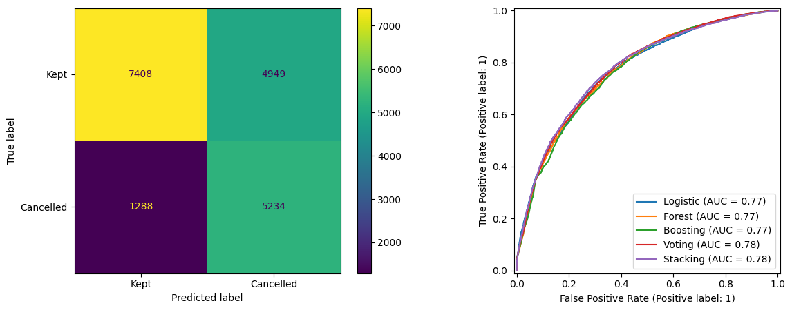

# Hotel booking cancellation prediction

An academic classification study using 119,390 historical bookings from two Portuguese hotels. Completed for M505, Introduction to AI and Machine Learning, at Gisma University of Applied Sciences.

**Author:** Ahmad Sajjad Siddiqui

[Open the executed notebook](hotel_cancellation_analysis.ipynb)

The project compares preprocessing choices, logistic regression, random forest, histogram boosting, soft voting and stacking. It also examines target-related fields, threshold selection, and performance by month and hotel.

## Results

The reproduced selection rule chooses **Voting**. On the original arrival-ordered test partition:

| Measure | Result |
|---|---:|
| Cleaned development / test rows | 68,354 / 18,879 |
| Test ROC-AUC | 0.7757 |
| Decision threshold | 0.23 |
| Cancellation precision | 0.514 |
| Cancellation recall | 0.803 |
| Cancellation F1 | 0.627 |

The threshold reduces an illustrative `3 × false negatives + false positives` score by 34.57% compared with threshold 0.50. The cost ratio is assumed; financial savings were not measured.



## What the evaluation establishes

These are **retrospective coursework results**. The training and test partitions share 22 April 2017, and five exact cleaned row patterns appear in both. The source uses a pre-arrival snapshot; availability of all retained features before cancellation or at an early booking decision is unverified. These facts limit claims of independent testing or operational usefulness.

The outer comparison uses expanding row-based folds, but the stacking comparator's inner folds are ordinary stratified folds. Boosting retains automatic early stopping, and the same development folds are reused for tuning and ranking. The ensemble's modest development margin is not evidence of a reliable business improvement. [Methodology review](reports/METHODOLOGY_REVIEW.md) records these points.

## Reproduce

The analytical run uses Python **3.11.6** with pinned NumPy, pandas, scikit-learn, SciPy and plotting dependencies. Set up a virtual environment:

```sh
python -m venv .venv
```

Activate with `.venv\Scripts\Activate.ps1` in PowerShell, or `source .venv/bin/activate` on macOS/Linux, then:

```sh
python -m pip install -r requirements-run.txt
python scripts/data.py --extract
python run_analysis.py
```

The archive and CSV are checked by SHA-256. The runner starts a fresh kernel and saves a separate executed notebook under `reports/`; the portfolio notebook is left unchanged. It defaults to two parallel workers and one numerical thread per process. The recorded run took 19.7 minutes including its private metric audit; runtime varies by hardware. Windows is the tested platform; see [validation](reports/VALIDATION.md) for the exact scope.

## Data and provenance

Source: Antonio, de Almeida and Nunes (2019), [Hotel booking demand datasets](https://doi.org/10.1016/j.dib.2018.11.126), *Data in Brief*, 22, 41–49, under [CC BY 4.0](https://creativecommons.org/licenses/by/4.0/). The supplied combined CSV matches the [TidyTuesday mirror](https://github.com/rfordatascience/tidytuesday/tree/main/data/2020/2020-02-11) byte for byte. The compressed snapshot is included; extracted data is excluded from Git. [Data notes](data/README.md) and [rights](RIGHTS.md) retain attribution.

The private final submission remains unchanged. Portfolio preparation removed the student identifier, bounded CPU use and clarified the interpretation. It did not change the split, preprocessing, grids, seeds, candidate definitions, selection rule or threshold procedure. Full metrics are in [reports/metrics.json](reports/metrics.json).
